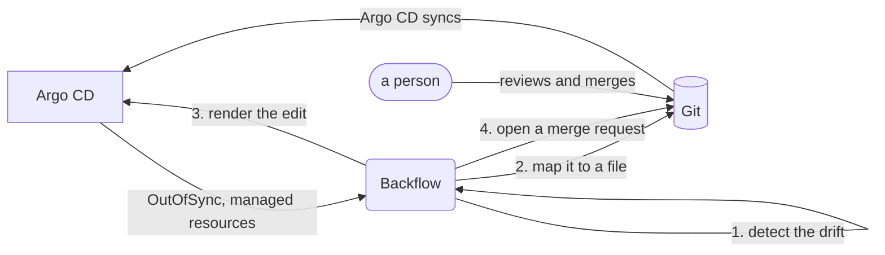

# Backflow

Reverse GitOps for Kubernetes and OpenShift. Backflow detects changes made directly in a cluster to resources that
Argo CD manages, and proposes them back to the Git source of truth as merge requests against the file that owns the
resource.

Backflow 1.0 is the first stable release: `backflow.io/v1` gets no breaking changes in 1.x.

## The problem

With Argo CD, Git is the source of truth. People still change the cluster directly: a `kubectl edit` during an
incident, `kubectl scale` under load, a value changed in the OpenShift console. Argo CD shows the Application as
`OutOfSync`, and then either `selfHeal` reverts the change, or somebody has to remember to port it to Git. Backflow
does that porting: it finds the change, finds the file that has to change, proves the edit is right, and opens a merge
request for a person to review.

## How it works



1. **Detect.** Backflow reads the Applications a `BackflowPolicy` selects, and through Argo CD's API the difference
   between what Git renders (desired) and what is live. The difference, after the fields you ignore, is a drift.
2. **Map.** It traces each drifted field back to the file and the line that owns it in Git: a plain manifest, a
   Kustomize patch or setting, a Helm value file (also for charts from a Helm repository or a registry).
3. **Verify.** It sends the edited files to Argo CD and asks it to **render the edited source again**; nothing is written
   to Git for this (only a chart from a Helm repository or a registry needs short-lived `backflow/scratch/` branches, deleted
   right after). Only an edit that reproduces the live state exactly is used. Anything else is `Unmapped` and left for a person.
4. **Propose.** The edit becomes a merge request (or a direct commit, if the policy says so). A person decides.

## Principles

- **Backflow never writes to the cluster.** Argo CD is the only thing that applies manifests. Backflow reads the cluster
  and writes to Git.
- **Git wins.** Backflow writes to Git as a proposal, by default a merge request. A human decides whether it becomes the
  source of truth; closing it lets Argo CD revert the cluster.
- **It never guesses.** A mapping is accepted only after it is verified by rendering. If a live change cannot be traced
  back with certainty, the proposal is `Unmapped` and says why.
- **Argo CD does the rendering.** Backflow reuses Argo CD's drift, normalisation, and Helm and Kustomize rendering; it
  does not reimplement them.

## Quick start

With Helm (3.8 or later):

```bash
helm install backflow oci://ghcr.io/sserkanml/charts/backflow \
  --version 1.0.0 --namespace backflow-system --create-namespace
```

Give it a read-only Argo CD account and a Git token, then a connection and a policy. In `ReportOnly` mode nothing is
written to Git:

```bash
kubectl -n backflow-system create secret generic argocd-token --from-literal=token="$ARGOCD_TOKEN"
kubectl -n backflow-system create secret generic gitlab-token --from-literal=token="$GITLAB_TOKEN"

kubectl -n backflow-system apply -f - <<'YAML'
apiVersion: backflow.io/v1
kind: ScmConnection
metadata: {name: gitlab}
spec:
  provider: GitLab                  # or GitHub
  url: https://gitlab.com
  tokenSecretRef: {name: gitlab-token, key: token}
---
apiVersion: backflow.io/v1
kind: BackflowPolicy
metadata: {name: my-apps}
spec:
  argoCD:
    namespace: argocd
    server:
      url: https://argocd-server.argocd.svc
      tokenSecretRef: {name: argocd-token, key: token}
  applications:
    names: [my-app]
  mode: ReportOnly                  # MergeRequest opens merge requests
YAML

kubectl -n backflow-system get scm,bfp,dp
```

A policy that names its own Argo CD server needs that server in `argocd.allowedServers` of the chart (the installer decides, not
the tenant), and the host of a connection has to be in `scm.allowedHosts` (`gitlab.com` and `github.com` are there by default):
see [Configuration](docs/configuration.md#allowed-servers-and-hosts).

Change something in the cluster (`kubectl scale`, `kubectl patch`), wait for the batch window (30 seconds by default),
and look at the `DriftProposal`. Then switch the policy to `MergeRequest`. The whole path, with the Argo CD account and
the token scopes, is in [Getting started](docs/getting-started.md).

On OpenShift, from OperatorHub (a catalog of its own; the settings are `BACKFLOW_*` variables):

```yaml
apiVersion: operators.coreos.com/v1alpha1
kind: CatalogSource
metadata: {name: backflow-catalog, namespace: openshift-marketplace}
spec:
  sourceType: grpc
  image: ghcr.io/sserkanml/backflow-catalog:stable
  displayName: Backflow
---
apiVersion: operators.coreos.com/v1alpha1
kind: Subscription
metadata: {name: backflow, namespace: openshift-operators}
spec:
  channel: stable
  name: backflow
  source: backflow-catalog
  sourceNamespace: openshift-marketplace
  config:
    env:
      - {name: BACKFLOW_SCM_ALLOWED_HOSTS, value: "gitlab.example.com,gitlab.com"}   # your self-hosted GitLab or GitHub
```

See [Install on OpenShift](docs/install/openshift.md) for OperatorHub and OpenShift GitOps (no token to create by hand:
the operator uses the local user that OpenShift GitOps manages), and [Install with Helm](docs/install/helm.md) and
[with kustomize](docs/install/kustomize.md).

## What a merge request looks like

Title: `backflow: sync ConfigMap demo/demo-config from cluster`. Description:

> Backflow found a change made directly in the cluster to a resource managed by Argo CD.
>
> - **Resource:** ConfigMap demo/demo-config
> - **Application:** argocd/demo-app
> - **Changed by:** unknown
> - **Changed with:** kubectl-patch (Update) at 2026-11-01 13:26:26 UTC
> - **Detected:** 2026-11-01 13:27:05 UTC
>
> | Path | Git value | Live value |
> |---|---|---|
> | /data/LOG_LEVEL | "info" | "debug" |
>
> ```diff
> --- a/apps/demo/configmap.yaml
> +++ b/apps/demo/configmap.yaml
> @@ -5,3 +5,3 @@
>  data:
> -  LOG_LEVEL: info
> +  LOG_LEVEL: debug
> ```
>
> DriftProposal: `backflow-system/demo-app-configmap-demo-config-3f2a9c`
>
> Merging this merge request makes the live change permanent: Git then matches the cluster. Closing it without merging
> lets Argo CD revert the cluster to what Git says.

For Helm and Kustomize the description lists the value file and key (or the patch) that changed, and says that the edit was
verified by rendering through Argo CD. A change that a controller made (an HPA changing the replicas) carries a note that
it was not made by a person.

## What it can do

- **Drift detection through Argo CD**, with ignored fields and included or excluded kinds per policy, batching of quick
  edits, and no proposal while Git is ahead of the last sync: [Concepts](docs/concepts.md).
- **Mapping to Git** for plain manifests (YAML and JSON), Kustomize overlays, Helm value files, charts from a Helm
  repository or an OCI registry with their values in Git, and values set in the Application:
  [What maps](docs/mapping/overview.md), [Helm](docs/mapping/helm.md), [Kustomize](docs/mapping/kustomize.md),
  [multi-source](docs/mapping/multi-source.md), [values set in the Application](docs/mapping/application-values.md),
  [JSON files](docs/mapping/json.md), [partial proposals](docs/mapping/partial-proposals.md).
- **Three modes:** `ReportOnly`, `MergeRequest` (GitLab merge requests, GitHub pull requests) and `DirectCommit`.
- **Who changed it:** the field manager from `managedFields`, and with the optional observe-only admission webhook the
  user: [Who changed it](docs/who-changed-it.md).
- **Multi-tenant by design:** allow lists for Git hosts and Argo CD servers, access rules for the default connection,
  Secrets read by name only: [Security](docs/security.md), [Configuration](docs/configuration.md).
- **Operations:** Prometheus metrics, alerts and a Grafana dashboard ([Metrics](docs/operations/metrics.md)), a
  [troubleshooting table](docs/operations/troubleshooting.md) of every reason, and [upgrades](docs/operations/upgrade.md).
- **Runs on** Kubernetes 1.30 or later and OpenShift 4.17 or later, with Argo CD 3.x, GitLab and GitHub.

## Compatibility and support

Semantic versioning from 1.0: `backflow.io/v1` gets no breaking change in 1.x, `v1beta1` is served but deprecated until 2.0,
and a deprecation is announced one minor release ahead. Backflow has a single maintainer: **only the latest minor release
of 1.x gets fixes**. The support matrix (Kubernetes, OpenShift, Argo CD, GitLab and GitHub, with what CI tests) and the
rules of the version number are in [Compatibility and support](docs/compatibility.md); known limits are in
[Limitations](docs/reference/limitations.md).

## More

- [All documentation](docs/README.md)
- [Security policy and how to report a vulnerability](SECURITY.md); [the security model](docs/security.md)
- [Development and tests](docs/development.md) and [design notes](docs/design)
- [Changelog](CHANGELOG.md)
- License: [MIT](LICENSE).
