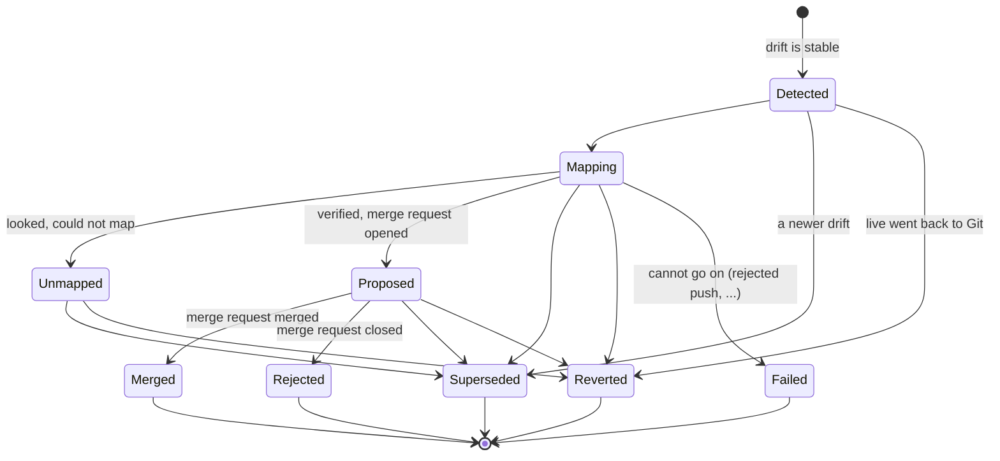

# Concepts

This page explains the parts of Backflow and how a drift becomes a merge request. It has no commands; for those see
[Getting started](getting-started.md).

## The resources

Backflow has three custom resources in the group `backflow.io` (`v1`).

| Kind | Short | Written by | Purpose |
|---|---|---|---|
| `ScmConnection` | `scm` | you | A Git host (GitLab or GitHub), its URL and the Secret that holds a token. A connection is matched to the repositories of an Application by host. It is `Ready` when the host accepts the token. |
| `BackflowPolicy` | `bfp` | you | Which Argo CD Applications to watch (by name or label selector), how to reach Argo CD, the mode, the kinds to include or exclude, ignored fields, Helm and mapping options, the batch window and the retention. An Application is managed by **one** policy only: the oldest wins, and any other policy that selects it is not `Ready` (`ApplicationConflict`). |
| `DriftProposal` | `dp` | the operator | One captured drift: what changed, where it comes from, and (in `status`) its journey. Its `spec` is an immutable observation. |

A fourth kind, `ChangeRecord` of `internal.backflow.io`, is private to the optional [actor webhook](who-changed-it.md#the-actor-webhook-who-it-really-was)
and not part of the API.

A policy, a connection and the Secrets they name live in the same namespace. Who may create them, and what they can make
the operator reach, is the subject of [Security](security.md).

## From a drift to a merge request

For every Application a `Ready` policy selects, Backflow does the following.

1. **Observe.** It reads the Application from the cluster (`status.sync`, `status.resources`) and, for the resources that
   are `OutOfSync`, the *predicted* (what Git renders, defaulted) and the *normalised live* state from Argo CD's API. The
   difference, after the built-in ignores and the policy's `ignoreFields`, is the drift: a list of field changes
   (`Add`, `Replace`, `Remove`, each a JSON pointer with the Git and the live value).
2. **Wait until the drift is stable** ([batching](#batching)), and until Git is not ahead of the last sync
   ([Git ahead](#git-ahead)).
3. **Create a `DriftProposal`.** There is at most one open proposal for the same changes of the same resource. A newer
   drift of the same resource supersedes the older proposal.
4. **Map.** The proposal controller reads the repository at the revision Argo CD synced (never the head of the branch) and
   finds the file that defines each drifted field: [what maps and what does not](mapping/overview.md).
5. **Verify.** It applies the edit to a copy of the source files and has Argo CD render that copy. The edit is accepted only
   if the render reproduces the drift exactly ([verification by render](#verification-by-render)).
6. **Propose.** According to the policy's [mode](#modes) it opens a merge request, commits to the branch, or only reports.
7. **Follow.** It polls an open merge request and records when it was merged or closed.

## Modes

The mode of a policy decides what happens after a proposal is mapped. Mapping runs in every mode.

| Mode | What Backflow writes to Git | When to use it |
|---|---|---|
| `ReportOnly` | nothing. The verified edit and its diff are in `status.mapping` of the `DriftProposal`. | trying it out, or when merge requests are made by other means |
| `MergeRequest` (default) | a branch `backflow/<proposal>-<uid>` and a merge request (a pull request on GitHub) against the tracked branch, with labels, reviewers and an assignee if the policy says so | the normal way |
| `DirectCommit` | a commit to the tracked branch, without review | only where nobody needs to review |

Backflow never writes to the cluster in any mode.

## The proposal lifecycle

| Phase | Meaning |
|---|---|
| `Detected` | The proposal exists and nothing else has happened yet. |
| `Mapping` | The proposal controller is mapping it, or retrying because it could not look (see [retried reasons](#mapping-conditions)). |
| `Unmapped` | The operator looked and could not map the change with certainty. `status.mapping.reason` and the `Mapped` condition say why; a person decides. **Open**: it can still become `Reverted` or `Superseded`. |
| `Proposed` | The edit is verified and, in `MergeRequest` mode, the merge request is open (`status.git`). |
| `Merged` | The merge request was merged (or the commit was made in `DirectCommit` mode). Git now holds the live change. |
| `Rejected` | The merge request was closed without merging. Argo CD can revert the cluster. |
| `Reverted` | The live change went back to what Git says, or the resource left the Application. |
| `Superseded` | A newer drift of the same resource replaced this one, or the policy can no longer see the Application (`AccessRevoked`). |
| `Failed` | The proposal cannot go on, for example a Git host that keeps declining the push (`PushRejected`). |

`Merged`, `Rejected`, `Reverted`, `Superseded` and `Failed` are final and never change again. Finished proposals are deleted
after 14 days (`spec.retention.finishedProposals` of the policy; `0s` keeps them); open and `Unmapped` ones never are.

Only the DriftProposal controller writes the status of a proposal. The drift controller creates the proposal and only
records facts for it (a newer drift, the live change returning) in `status.signals`, which the proposal controller turns
into phases.

### Conditions

| Resource | Condition | Meaning |
|---|---|---|
| `ScmConnection` | `Ready` | The host accepts the token. |
| `BackflowPolicy` | `Ready` | The policy resolves its Applications, has an Argo CD connection and (unless `ReportOnly`) a connection for the repositories. |
| `DriftProposal` | `Mapped` | `True` when the change was mapped to Git (`Mapped`, or `PartiallyMapped`); `False` with a reason otherwise. |
| `DriftProposal` | `Proposed` | `True` when a merge request was opened or a commit made; `False` with a reason while it waits or when it failed. |
| `DriftProposal` | `CleanedUp` | The branches and the merge request were closed after the proposal ended. |

Every reason and what to do about it is in [Troubleshooting](operations/troubleshooting.md).

### Mapping conditions

A reason of the `Mapped` condition is one of two kinds. **Final** ones end the proposal in `Unmapped` (for example `NotFound`,
`Ambiguous`, `VerificationFailed`, `UnsupportedSourceType`): the operator looked and could not map. **Retried** ones keep the
phase `Mapping` and are tried again with a growing delay, up to ten minutes, without giving up (`RepositoryUnavailable`,
`RepositoryAuthFailed`, `RepositoryNotFound`, `ApplicationNotFound`): the operator could not *look*, which is not the same as
having looked and failed. They recover by themselves when an `ScmConnection` or a Secret changes.

## Verification by render

This is the rule that keeps Backflow from guessing. A candidate edit (a key in a value file, a patch, a line of a manifest) is
never trusted because it looks right. Backflow applies it to a copy of the source files and asks Argo CD to render that copy
(`GetManifestsWithFiles`, or a render by revision for a chart whose values are in another repository). The edit is accepted only
when the fields it changes, in **all** rendered resources, are the drifted fields and now have their live values. Otherwise the
proposal is `Unmapped` with a reason such as `NoVerifiedCandidate`, `RenderMismatch` or `AmbiguousCandidates`.

Resources with a hook annotation and resources named at random by a chart are left out of the comparison. Argo CD does the
rendering, so a chart is rendered with the Helm or Kustomize version and the settings of the Argo CD that deploys it.

## Batching

A drift becomes a proposal only after it has been stable: seen with the same changes, at the same synced and compared revision,
for the policy's `spec.batchWindow` (default `30s`), across at least two observations. A drift that disappears within the window
is never proposed, and several quick edits to a resource give one proposal for the final state. This also covers the moment
after a sync, when Argo CD can still show a resource as `OutOfSync`. What was seen is kept in memory; after a restart the window
starts again, which only delays a proposal.

## Git ahead

While Git is ahead of the last sync of an Application (a manual sync, or a failing sync), an `OutOfSync` resource may differ from
the cluster only because a commit has not been applied yet, and a proposal could revert that commit. So drift detection for that
Application is paused, with one Event on the policy saying so, until a complete, successful sync of the current source. Only the
files that can change the render count, so a commit elsewhere in the repository does not pause anything. The exact rules, per
source type, are under [Limitations](reference/limitations.md).

## Partial proposals

By default a proposal is all or nothing: when one drifted field cannot be traced back to Git, the whole proposal is `Unmapped`.
A policy can opt in with `spec.mapping.allowPartial: true` to propose what can be proven. The fields that are left out are listed
in `status.mapping.unmapped` and in the merge request, with a warning that the next sync resets them. See
[Partial proposals](mapping/partial-proposals.md).

## Who changed it

A proposal can name the field manager that wrote the drifted fields (from `managedFields`) and, with the optional webhook, the
user. See [Who changed it](who-changed-it.md).
